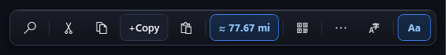
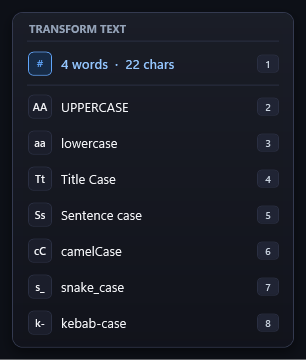
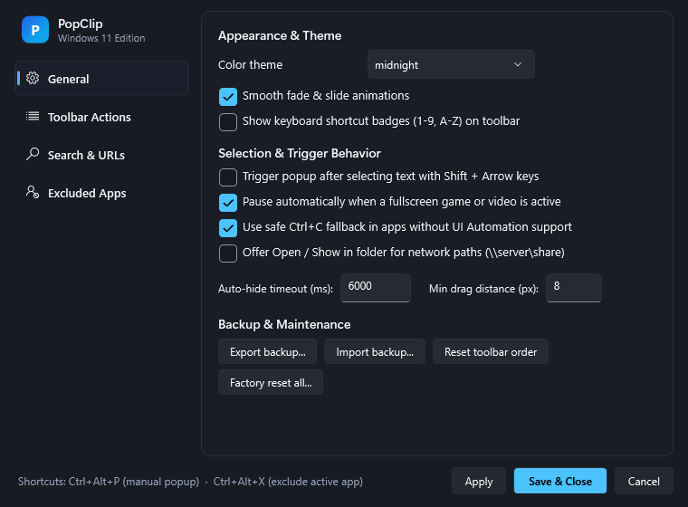
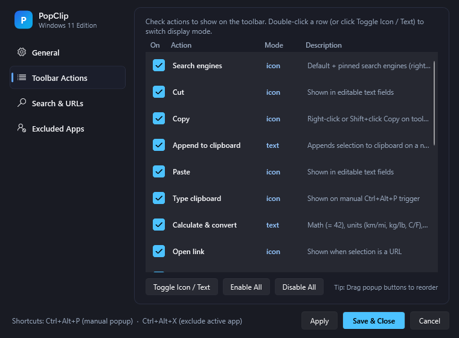
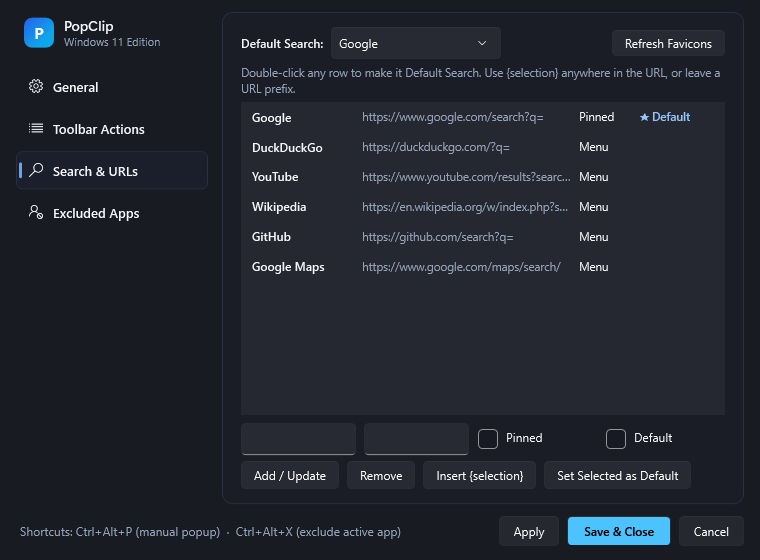

<div align="center">

# ✦ SparkBar for Windows 11

**An ultra-fast, featherlight contextual action bar & smart pill popup for Windows 11.**

[](https://dotnet.microsoft.com/)
[](https://www.microsoft.com/windows)
[](LICENSE)

</div>

---

**SparkBar** brings an instant, native Windows 11 floating toolbar to your cursor whenever you highlight text via mouse drag, double/triple-click, or `Shift + Arrow` keys. Built on .NET 10 with direct COM vtable UI Automation (`IUIAutomation`), pre-warmed DWM hardware flyouts, and zero external NuGet dependencies, SparkBar pops up in **under 25 ms** while using minimal RAM.



---

## ✨ Key Features

- **⚡ Instantaneous Pre-Warmed DWM Flyouts (`< 25 ms`)**
  - Uses persistent, pre-warmed Win32 `HWND`s with native Windows 11 Desktop Window Manager (`DWMWA_WINDOW_CORNER_PREFERENCE`, `DWMWA_BORDER_COLOR`, and Mica/Acrylic backdrops) instead of slow software-layered windows.
- **🧠 Smart Contextual Pills**
  - **Math Calculator**: Evaluates arithmetic and scientific expressions inline (`24 * (7 + 3)` → `= 240`, `sqrt(144) + 8` → `= 20`, `2 * pi * 10`, `sin`, `cos`, `tan`, `log`, `ln`, `abs`, `round`).
  - **Unit, Base & Timestamp Converter**: Automatically converts lengths (`km` ↔ `mi`, `m` ↔ `ft`, `cm` ↔ `in`, `mm` ↔ `in`), weights (`kg` ↔ `lbs`, `g` ↔ `oz`), temperatures (`°C` ↔ `°F`), speeds (`km/h` ↔ `mph`, `m/s` ↔ `km/h`), volumes (`L` ↔ `gal`, `mL` ↔ `fl oz`), areas (`sqft` ↔ `m²`), data sizes (`TB`/`GB`/`MB`/`KB`), hex (`0x...`), binary (`0b...`), and 10/13-digit Unix timestamps (`🕒 UTC`).
  - **Live Color Swatch & Format Converter**: Selecting `#RGB`, `#RRGGBB`, or `rgb(r, g, b)` displays a live color tile on the toolbar. Right-click the swatch to copy as **HEX**, **RGB**, or **HSL**.
  - **URL, Email & File Path Actions**: Offers **Open link**, **Clean URL** (strips `utm_*`, `fbclid`, `gclid`, `msclkid`, etc.), **Copy domain**, **Save URL as action** (`+Search`), **New email** (`mailto:`), **Open file**, and **Show in Explorer**.
- **🔤 Developer & Markdown Text Transforms (`Aa` Menu)**
  - One-click transforms: `UPPERCASE`, `lowercase`, `Title Case`, `Sentence case`, `camelCase`, `PascalCase`, `snake_case`, `kebab-case`, `CONSTANT_CASE`, `Wrap in "quotes"`, `Collapse whitespace`, `Remove line breaks`.
  - **Context-Aware Developer Tools**:
    - **Auto-JSON**: Pretty-print or minify selected JSON (`{...}` / `[...]`).
    - **Auto-Base64**: Live preview and one-click decoding of Base64 strings.
    - **Smart Markdown Link**: When your clipboard contains a URL, selecting text offers `Wrap as Markdown [text](url)`.
    - **Multi-Line Utilities**: `Sort lines A-Z`, `Trim & dedupe lines`, `Number lines (1. 2.)`, and `Bullet lines (•)`.
- **📋 Lightweight Clipboard History Ring (`Ctrl + Alt + V`)**
  - Keeps a bounded ring of your last 12 copied snippets (`< 48 KB` memory cap). Right-click **Paste** on the toolbar or press `Ctrl + Alt + V` to paste any recent clip or join all clips.
  - Automatically tags temporary fallback probes with Windows' `ExcludeClipboardContentFromMonitorProcessing` / `CanIncludeInClipboardHistory = 0` flags so your Windows `Win + V` history stays clean.
- **📱 100% Offline QR Code Generator**
  - Built-in pure C# ISO/IEC 18004 QR Code encoder (Versions 1–20, Reed-Solomon GF(256)) generates crisp QR codes in `< 1 ms` offline with **Copy Image** and **Save PNG** actions—no third-party server required.
- **🔍 Unified Search Engines & Desktop App URI Actions**
  - Pin your favorite search engines with automatic high-DPI favicon caching, or trigger installed desktop apps directly via custom URI schemes (`obsidian://`, `vscode://`, `spotify:`, `es:`).

---

## 📸 Screenshots

| Transform Text (`Aa`) Menu | Windows 11 Fluent Settings — General |
| :---: | :---: |
|  |  |

| Toolbar Actions Customization | Search Engines & Web Actions |
| :---: | :---: |
|  |  |

---

## 🚀 Custom App URI Examples

In **Settings → Search & URLs**, you can add both web search engines and **local desktop app URI schemes** using `{selection}`:

| App | Action Name | URI Template | Description |
| :--- | :--- | :--- | :--- |
| **Everything** | `Everything` | `es:{selection}` | Instantly search your local hard drive for the selected filename in *Everything*. |
| **Spotify** | `Spotify` | `spotify:search:{selection}` | Search the selected song or artist directly inside the Spotify desktop app. |
| **Obsidian** | `Obsidian Note` | `obsidian://new?vault=Notes&content={selection}&append=true` | Append the selected text directly into your local Obsidian vault. |
| **VS Code** | `Open in VS Code` | `vscode://file/{selection}` | Open a selected file path (including `file.cs:line`) directly in VS Code. |
| **Telegram** | `Telegram Share` | `tg://msg_url?url={selection}` | Share a selected link or snippet to a Telegram chat. |
| **Windows Maps** | `Maps` | `bingmaps:?q={selection}` | Open a selected address in the native Windows Maps app. |

---

## ⌨️ Keyboard & Mouse Shortcuts

| Shortcut / Gesture | Action |
| :--- | :--- |
| **Mouse Drag / Double-Click / Triple-Click** | Show SparkBar above selected text |
| **`Ctrl + Alt + P`** | Manually trigger SparkBar (uses selection, or opens in **Clipboard Mode** with *Type Clipboard*) |
| **`Ctrl + Alt + V`** | Open the **Clipboard History** flyout menu |
| **`Ctrl + Alt + X`** | Instantly exclude or re-enable the currently active application (`.exe`) |
| **`1` – `9`, `A` – `Z`** *(while bar/menu is open)* | Trigger the corresponding toolbar button or menu item via keyboard |
| **`Right-Click` on Copy** *(or `Shift + Click`)* | Append selection to clipboard on a new line (`+Copy`) |
| **`Right-Click` on Paste** | Open the **Clipboard History** flyout menu |
| **`Right-Click` on Default Search** | Open the Quick Default Search Engine switcher |
| **`Right-Click` on Pinned Search** | Set that engine as your new Default Search Engine live |
| **`Right-Click` on Color Swatch** | Open the **HEX / RGB / HSL** color format copy menu |
| **`Drag` any button on SparkBar** | Reorder buttons on the toolbar live |
| **`Middle-Click` System Tray Icon** | Toggle SparkBar between **Active** and **Paused** |

---

## 🛠️ Building from Source

### Prerequisites
- Windows 10 (build 19041+) or Windows 11
- [.NET 10.0 SDK](https://dotnet.microsoft.com/download/dotnet/10.0) (Windows Desktop workload)

### Build & Run
```powershell
git clone https://github.com/yourusername/SparkBar.git
cd SparkBar
dotnet build -c Release
.\bin\Release\net10.0-windows\SparkBar.exe
```

To open the Settings window directly on launch:
```powershell
.\bin\Release\net10.0-windows\SparkBar.exe --settings
```

---

## 📄 License

Licensed under the [MIT License](LICENSE).
